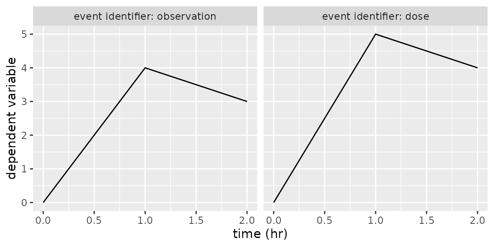
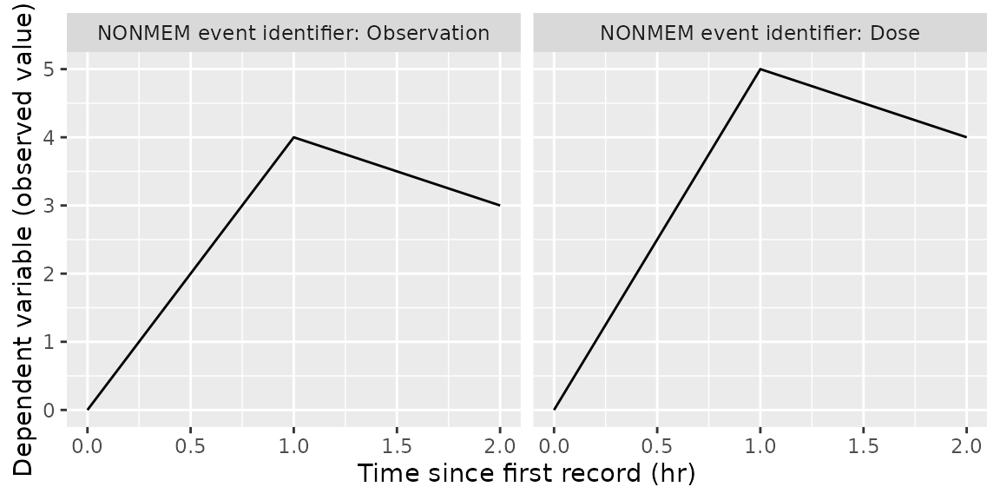

# Building, sorting and using specifications

This vignette covers creating a yspec specification from a data frame,
putting its variables in data order, saving it, starting from the
bundled NONMEM specification, and using a specification to label plots.

``` r

library(yspecx)
```

## Create a specification from a data frame

[`df_to_yspec()`](https://omarashkar.github.io/yspecx/reference/df_to_yspec.md)
writes a yspec YAML file from a data frame that describes the variables.

``` r

variables <- data.frame(
  name = c("WEIGHT", "SEX", "AGE", "ID"),
  label = c("Body weight", "Sex", "Age", "Subject identifier"),
  unit = c("kg", NA, "years", NA),
  type = c("numeric", "character", "numeric", "numeric"),
  codes = c(NA, "F=Female, M=Male", NA, NA)
)

path <- tempfile(fileext = ".yaml")
df_to_yspec(
  variables,
  desc = "Example data set",
  varname = "name",
  vardesc = "label",
  varunit = "unit",
  vartype = "type",
  varcodelist = "codes",
  output = path
)
#> YAML file created: /tmp/RtmpiRk9g4/file1b22a5fe78f.yaml
spec <- yspec::ys_load(path)
names(spec)
#> [1] "WEIGHT" "SEX"    "AGE"    "ID"
```

Entries in the code list may be `code=label` or `label=code`, separated
by commas or new lines. Supply `codelist_func` to parse another format.

## Put variables in data order

[`ys_sort_spec_vars()`](https://omarashkar.github.io/yspecx/reference/ys_sort_spec_vars.md)
orders the specification to match the columns of a data frame.
Specification variables that are not in the data follow, in their
original order, and data columns that are not in the specification are
ignored.

``` r

data <- data.frame(ID = 1, AGE = 35, SEX = "F", WEIGHT = 65)
sorted <- ys_sort_spec_vars(data, spec)
names(sorted)
#> [1] "ID"     "AGE"    "SEX"    "WEIGHT"
```

## Save a specification

[`ys_write()`](https://omarashkar.github.io/yspecx/reference/ys_write.md)
writes a loaded or sorted specification back to YAML. The output is a
standalone specification: lookup results are written in full, derived
fields are omitted, and comments and formatting are not kept.

``` r

out <- tempfile(fileext = ".yaml")
ys_write(sorted, out)
names(yspec::ys_load(out))
#> [1] "ID"     "AGE"    "SEX"    "WEIGHT"
```

## Start from the NONMEM specification

[`ysx_load_pkpdspec()`](https://omarashkar.github.io/yspecx/reference/ysx_load_pkpdspec.md)
loads a specification of standard NONMEM columns such as `ID`, `TIME`,
`DV`, `CMT`, `EVID` and `AMT`. Its `missing_code` is `-999`, `DV` allows
missing values, and `ID` is the group column.

``` r

pkpd <- ysx_load_pkpdspec()
head(names(pkpd), 10)
#>  [1] "C"    "NUM"  "ID"   "TIME" "TAFD" "TAD"  "SEQ"  "OCC"  "CMT"  "EVID"
pkpd$EVID$decode
#> [1] "observation"    "dose"           "other"          "reset"         
#> [5] "reset and dose"
```

## Label plots from a specification

[`ysx_plt_relab()`](https://omarashkar.github.io/yspecx/reference/ysx_plt_relab.md)
relabels axis and legend titles and
[`facet_wrap()`](https://ggplot2.tidyverse.org/reference/facet_wrap.html)
or
[`facet_grid()`](https://ggplot2.tidyverse.org/reference/facet_grid.html)
strips from a specification, with units on axis titles. Coded facet
values are decoded.

``` r

library(ggplot2)

dose <- data.frame(
  TIME = c(0, 1, 2, 0, 1, 2),
  DV = c(0, 4, 3, 0, 5, 4),
  EVID = c(0, 0, 0, 1, 1, 1)
)
```

``` r

p <- ggplot(dose, aes(TIME, DV)) +
  geom_line() +
  facet_wrap(~EVID)

ysx_plt_relab(p, pkpd)
```



Use `label_type = "long"` or `"short"` to choose the specification
field. An error is raised if that field is missing for a plotted
variable. Use `labs` for custom labels, `facet_labels` for individual
facet levels, and `var_map` when the data name differs from the
specification name.

``` r

renamed <- setNames(dose, c("time", "conc", "evid"))
p2 <- ggplot(renamed, aes(time, conc)) +
  geom_line() +
  facet_wrap(~evid)

ysx_plt_relab(
  p2,
  pkpd,
  var_map = c(time = "TIME", conc = "DV", evid = "EVID"),
  label_type = "long",
  facet_labels = list(evid = c(`0` = "Observation", `1` = "Dose"))
)
```


